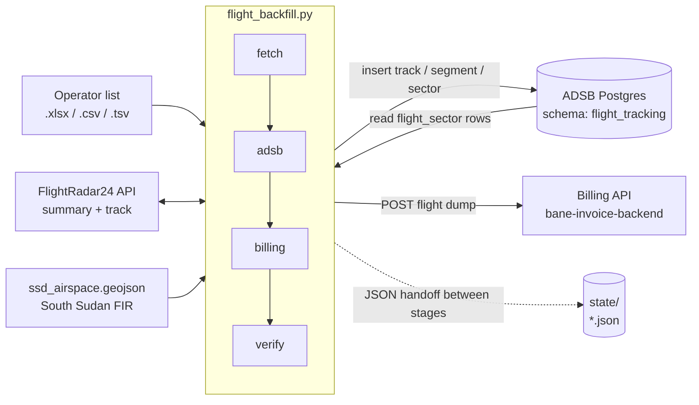
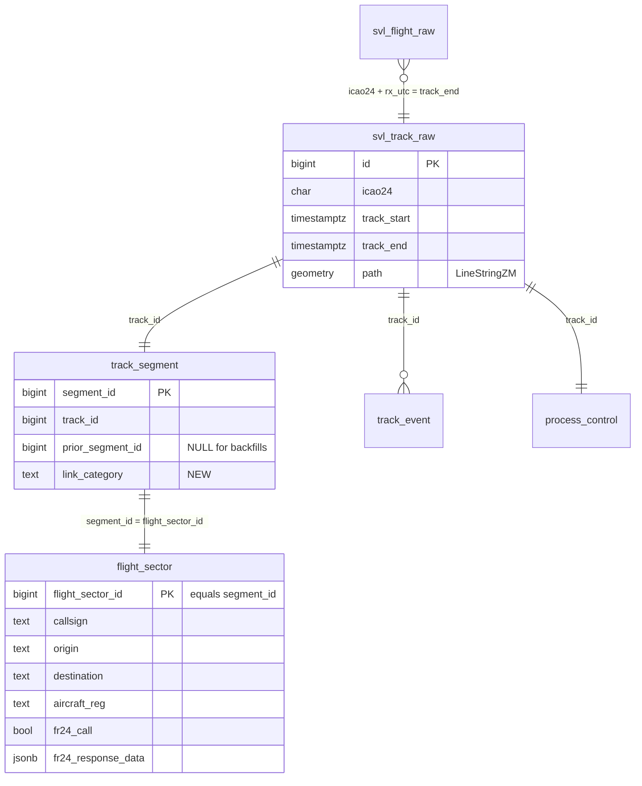
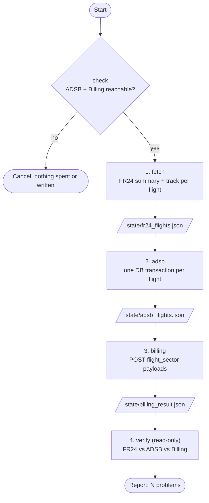
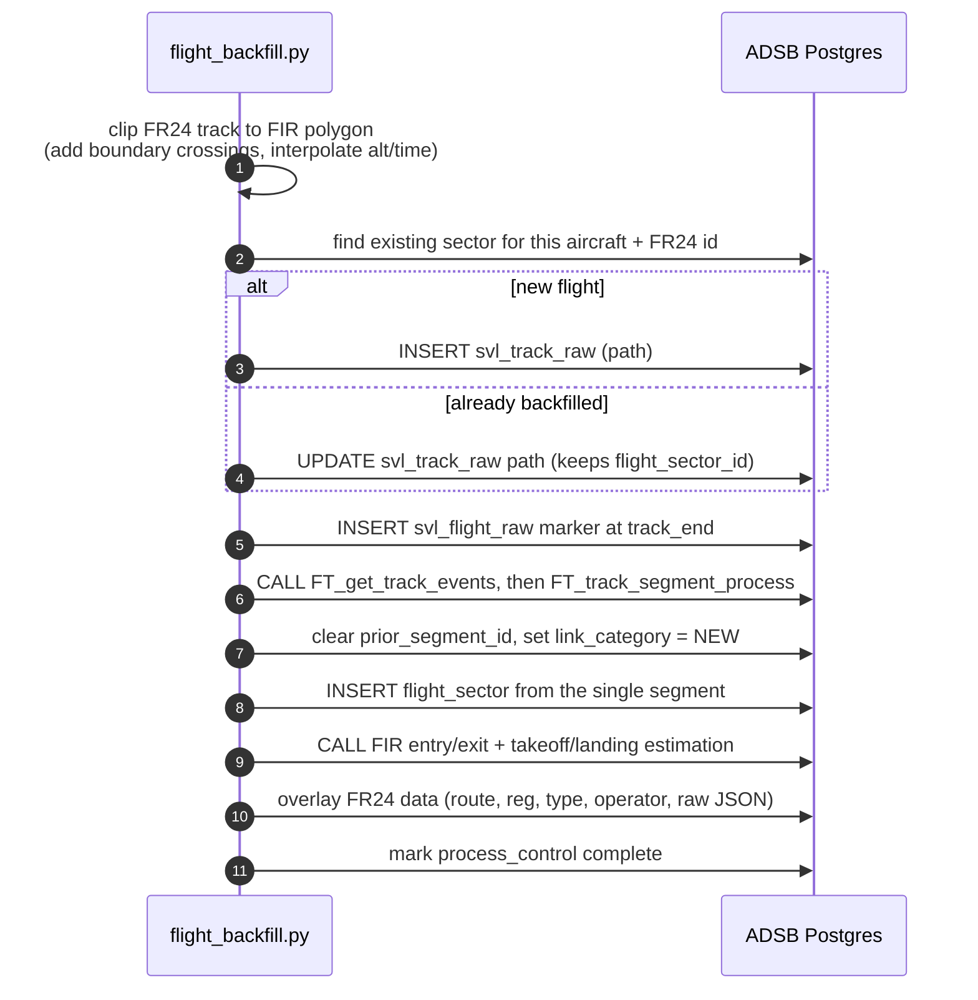
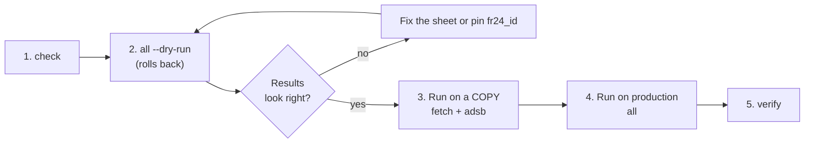
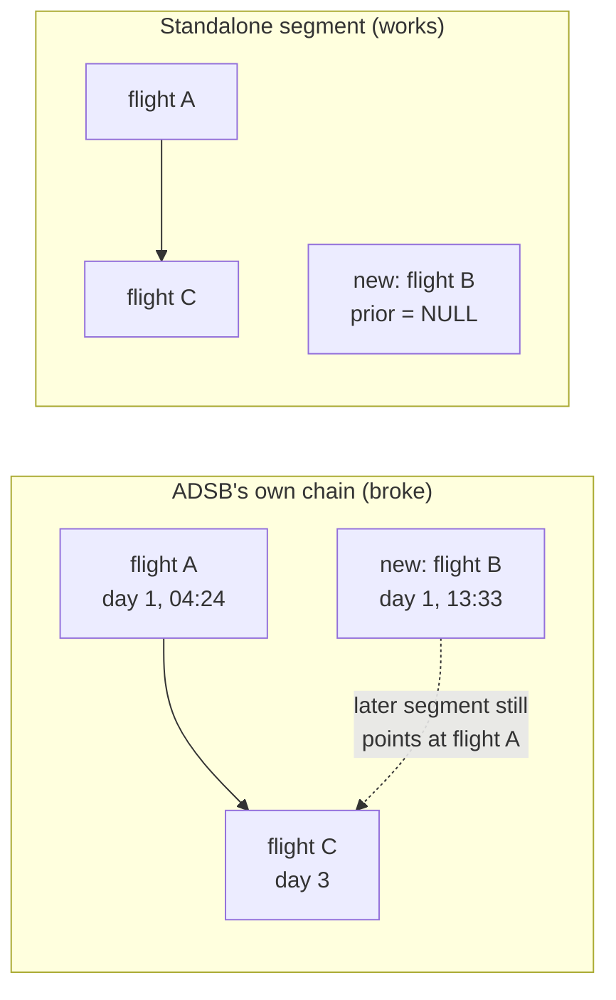

# flight-backfill

A standalone command-line tool that **backfills flights that ADSB never recorded**: it takes a list of
flights (an operator's Excel/CSV sheet), fetches the real track from **FlightRadar24 (FR24)**, writes it
into the **ADSB database** as if ADSB had tracked it live, and then posts the resulting flights to the
**Billing** system so they can be invoiced.

> Built for backfilling flights over the South Sudan FIR (any FIR polygon can be supplied).

---

## Contents

1. [Why this exists](#1-why-this-exists)
2. [Architecture](#2-architecture)
3. [The pipeline, stage by stage](#3-the-pipeline-stage-by-stage)
4. [Use cases](#4-use-cases)
5. [Setup](#5-setup)
6. [Run guide](#6-run-guide)
7. [Input file format](#7-input-file-format)
8. [State files](#8-state-files)
9. [Offline route: generate SQL instead of writing directly](#9-offline-route-generate-sql-instead-of-writing-directly)
10. [Design decisions](#10-design-decisions)
11. [Troubleshooting](#11-troubleshooting)
12. [Safety checklist](#12-safety-checklist)

---

## 1. Why this exists

ADSB normally builds flights from live receiver data. When receivers are down or coverage has a gap,
flights that crossed the FIR are missing, so they never reach Billing and **are never invoiced**. The
operator (the civil aviation authority) can still supply a list of those flights.

This tool closes the gap:

| Problem | What the tool does |
|---|---|
| Flight happened but ADSB has no record | Fetches the track from FR24 and inserts it into ADSB |
| Billing only knows flights that exist in ADSB | Sends the new `flight_sector` rows to Billing |
| Only the part inside the FIR is billable | Clips the FR24 track to the South Sudan FIR polygon |
| Manual data entry is error-prone | Cross-checks every stage with a read-only `verify` |

---

## 2. Architecture

### 2.1 System context



### 2.2 Components

| File | Role |
|---|---|
| [`flight_backfill.py`](flight_backfill.py) | The tool. Sub-commands: `check`, `fetch`, `adsb`, `billing`, `verify`, `all` |
| [`gen_prod_sql.py`](gen_prod_sql.py) | Optional. Turns flights already backfilled in a *local* ADSB DB into a reviewable SQL file |
| [`ssd_airspace.geojson`](ssd_airspace.geojson) | FIR boundary used to clip tracks (same boundary ADSB's geo-filter uses) |
| [`flights.example.csv`](flights.example.csv) | Small sample input |
| `.env` / `.env.prod` | Connection settings (never committed). Template: [`.env.example`](.env.example) |
| `state*/` | Per-run JSON handoff files between stages |

### 2.3 Data written to ADSB for each flight



`flight_sector_id` **is** the segment's id (a foreign key to `track_segment`). That id is what
Billing stores as `source_reference_id`, so it must never change once Billing has seen it.

---

## 3. The pipeline, stage by stage



### 3.1 `check` (pre-flight)
Connects to the ADSB DB and confirms the five tables the tool writes to exist. Then calls Billing's
token endpoint and sends an **empty list** to the flight-dump endpoint, which authenticates but
writes nothing. `all`, `adsb`, and `billing` run this automatically *before spending any FR24 credits*.

### 3.2 `fetch`
For each row in the sheet:
1. Looks up the FR24 flight by **call sign + date** (or by a pinned `fr24_id` column).
2. If there are several candidates, ranks them: registration match, then route match, then finished
   flights, then most recent. The choice is logged so you can pin it.
3. Warns when the sheet and FR24 disagree (registration, departure, destination).
4. Downloads the track points (needs at least 2).
5. Sleeps 2 s between calls (FR24 plan: 30 requests/minute) and retries 429/5xx with back-off.

Flights FR24 cannot find are recorded as failures and skipped later; they do not stop the run.

### 3.3 `adsb`
Each flight runs in **its own transaction** (a failure rolls back only that flight):



The overlay makes **FR24 the authority** for route, registration, type and operator, and sets
`fr24_call = true`. `process_control.complete = true` stops ADSB's live pipeline from reprocessing it.

### 3.4 `billing`
Reads each new `flight_sector` back from ADSB using the same column list ADSB's own
`Billing.send()` uses, then POSTs the batch to `/api/third-party-flight-dump/` with a bearer token
obtained from `/api/third-party/token/`. Reports `created / updated / failed` counts and prints any
per-flight rejection.

### 3.5 `verify` (read-only)
Re-reads ADSB and compares it to FR24: icao24, origin, destination, registration, type, path point
count, `fr24_call`, FIR entry. Shows whether each flight was sent to Billing. Exit code 1 if anything
is missing or differs.

---

## 4. Use cases

| # | Scenario | Command |
|---|---|---|
| 1 | **Normal backfill** of a day's missing flights, end to end | `all` |
| 2 | **Rehearse safely**: fetch and run the ADSB inserts, then roll everything back | `all --dry-run` |
| 3 | **Test on a copy** of the database without touching Billing | `fetch` then `adsb` with `ADSB_DB_NAME=my_copy_db` |
| 4 | **Re-fetch only** (e.g. FR24 data updated) | `fetch` |
| 5 | **Preview the Billing payload** before sending | `billing --dry-run` |
| 6 | **Resend to Billing** after a Billing outage | `billing` |
| 7 | **Audit** what was loaded | `verify` |
| 8 | **Pick the right flight** when FR24 returns several for one call sign | add an `fr24_id` column, re-run `fetch` + `adsb` |
| 9 | **Review before writing to production**: generate a SQL file from a local run | `gen_prod_sql.py` |
| 10 | **Fix a bad flight**: re-run; it updates the path and keeps the same `flight_sector_id` so Billing's link survives | `fetch` + `adsb` |

---

## 5. Setup

Requires Python 3.10+ and network access to FR24, the ADSB Postgres, and the Billing API.

```bash
cd flight-backfill
python3 -m venv .venv
.venv/bin/pip install -r requirements.txt
cp .env.example .env          # then fill it in
```

`.env` settings:

| Variable | Meaning |
|---|---|
| `FR24_API_TOKEN` | FR24 API token |
| `ADSB_DB_HOST` / `ADSB_DB_PORT` | Postgres host and port |
| `ADSB_DB_NAME` / `ADSB_DB_USER` / `ADSB_DB_PASSWORD` | Database and credentials |
| `BILLING_API_ROOT` | e.g. `http://billing-host:5011` |
| `BILLING_API_STATIC_TOKEN` | Static token exchanged for a bearer token |
| `FIR_GEOJSON` | Optional. Path to a different FIR polygon |

Use one env file per target and pick it with `--env-file`:

| File | Target |
|---|---|
| `.env` | Local database and local Billing |
| `.env.prod` | Production database and production Billing |

An environment variable set in the shell **overrides** the env file, e.g.
`ADSB_DB_NAME=my_copy_db` pointed at the copy while keeping the rest of `.env.prod`.

**Remote database access:** the Postgres server's `pg_hba.conf` must allow your IP for that specific
database, e.g. `host my_copy_db <db_user> <your-ip>/32 md5`, followed by `SELECT pg_reload_conf();`.

---

## 6. Run guide

All commands run from the `flight-backfill` folder. Global options go **before** the sub-command.

```
flight_backfill.py [--env-file FILE] [--state-dir DIR] <command> [options]
```

### 6.1 Recommended order for a real batch



**1. Check connections**
```bash
.venv/bin/python flight_backfill.py --env-file .env.prod check
```

**2. Dry run** (fetches from FR24, tries the ADSB inserts, rolls back, skips Billing)
```bash
.venv/bin/python flight_backfill.py --env-file .env.prod --state-dir state_dry \
  all flights.xlsx --sheet Sheet1 --date 2026-01-15 --dry-run
```

**3. Test on the copy database, without Billing**
```bash
export ADSB_DB_NAME=my_copy_db
run() { .venv/bin/python flight_backfill.py --env-file .env.prod --state-dir state_copy "$@"; }
run fetch flights.xlsx --sheet Sheet1 --date 2026-01-15
run adsb
run verify
```

**4. Production, everything including Billing**
```bash
.venv/bin/python flight_backfill.py --env-file .env.prod --state-dir state_run \
  all flights.xlsx --sheet Sheet1 --date 2026-01-15
```
A 30-flight run takes about 15 minutes (FR24 rate limit plus about 25 s per ADSB insert). Run it in a
terminal that will not be closed.

### 6.2 Command reference

| Command | Reads | Writes | Notes |
|---|---|---|---|
| `check` | DB, Billing | nothing | Billing check sends an empty list |
| `fetch <file>` | FR24 | `fr24_flights.json` | `--sheet`, `--date` (required unless the sheet has dates) |
| `adsb` | `fr24_flights.json` | ADSB DB, `adsb_flights.json` | `--dry-run` rolls back every flight |
| `billing` | `adsb_flights.json`, DB | Billing, `billing_result.json` | `--dry-run` prints the payload only |
| `verify` | all state files, DB | nothing | Exit 1 on any problem |
| `all <file>` | FR24, DB | everything | `--dry-run` stops after the ADSB dry run |

Options: `--sheet NAME` selects a workbook tab (default: active tab). `--date YYYY-MM-DD` is the
operation date for rows with no date column. **There is no default date**: if a row has neither a
`date` column nor `--date`, the run stops before contacting FR24.

### 6.3 Reading the output

`verify` prints one line per flight:

```
flight                FR24    ADSB    BILLING  notes
FLT101@2026-01-15    ok      ok      sent     sector=1001 state=END
FLT102@2026-01-15    FAIL    -       -        no FR24 flight found
```

| Column | Values |
|---|---|
| FR24 | `ok`, `FAIL` (not found, or fewer than 2 track points) |
| ADSB | `ok`, `DIFF` (a field differs from FR24), `MISSING` |
| BILLING | `sent`, `NOT SENT`, `REJECTED`, `HTTP <code>` |

A flight failing at one stage does not stop the others. Re-running is safe: an already-backfilled
flight is updated in place and keeps its `flight_sector_id`.

---

## 7. Input file format

`.xlsx`, `.xlsm`, `.csv` or `.tsv`. The header row is found automatically (the first row containing
**CALL SIGN**), so title rows above it are fine.

| Column (any of these headers) | Required | Purpose |
|---|---|---|
| `CALL SIGN` / `callsign` | **yes** | FR24 lookup key |
| `A/C REGISTRATION` / `reg` | no | Match hint; used if FR24 has none |
| `OPERATER` / `operator` | no | Fallback operator |
| `A/C TYPE` / `type` | no | Fallback aircraft type |
| `DEPARTURE`, `DESTINATION` | no | Match hint and fallback route |
| `ROUTE` | no | Informational |
| `date` | no* | `YYYY-MM-DD`. *Required unless you pass `--date` |
| `fr24_id` | no | **Pins** the exact FR24 flight, skipping the search |

```csv
A/C REGISTRATION,CALL SIGN,OPERATER,A/C TYPE,DEPARTURE,DESTINATION,ROUTE
AB-CDE,ABC123,ABC,B738,AAAA,BBBB,R1
```

---

## 8. State files

Each stage writes JSON into `--state-dir` (default `state/`) and the next stage reads it. Use a
separate folder per run so earlier results are not overwritten.

| File | Written by | Contents |
|---|---|---|
| `fr24_flights.json` | `fetch` | Per flight: input row, FR24 summary, all track points, or an `error` |
| `adsb_flights.json` | `adsb` | Per flight: `flight_sector_id`, `track_id`, segment ids, point count, action |
| `billing_result.json` | `billing` | HTTP status, keys sent, Billing's full response |


---

## 9. Offline route: generate SQL instead of writing directly

When someone must review and run the SQL by hand (for example the production DB is only reachable by a
DBA), run the tool against a **local** ADSB database first, then export what it created:

```bash
.venv/bin/python gen_prod_sql.py --env-file .env --since 2026-01-15 --out backfill_to_prod.sql
# --since is required: export flights whose FR24 enrichment happened on/after this date
```

The generated file is **one transaction** that, per flight, inserts `svl_track_raw`,
`track_segment` (`prior_segment_id` NULL), `flight_sector`, plus `track_event`, `svl_flight_raw` and
`process_control`. Properties:

- New ids come from the **target's** sequences, so local ids are not reused.
- Aborts if a flight already exists in the target; it never modifies existing rows.
- Ends with a result `SELECT` (call sign, `flight_sector_id`, `track_id`) and a count check.
- **Does not commit.** Review the output, then type `COMMIT;` (or `ROLLBACK;`).
- Billing/POD bookkeeping columns (`has_synched`, `pod_*`, `public_link`) start at their defaults.

The generated SQL contains no passwords or tokens, but it does contain flight data, so treat it as internal.

---

## 10. Design decisions

**Clip to the FIR.** Only the portion inside the South Sudan FIR is billable. Points inside are kept
as-is; where a segment crosses the boundary (including across an FR24 coverage gap) a crossing point is
added with time and altitude interpolated.

**Units follow ADSB conventions.** Altitude in feet; `-999` = on the ground; `-1000` = no altitude;
the path's M value is epoch seconds.

**Each backfilled flight is a standalone segment (`prior_segment_id` is NULL).**
ADSB's `FT_segment_flight` walks `prior_segment_id` links to find where a flight ends. If the aircraft
already has *later* segments, the next segment still points past the new one, the computed end lands
before the start, and ADSB creates **no** `flight_sector`. This was found while backfilling a flight,
because the production database already held later flights for that aircraft. The tool therefore derives the
sector from the single segment (same columns and logic as ADSB) and leaves existing segments
untouched. The FIR and takeoff/landing procedures still run through ADSB's own functions.



**Idempotent by design.** Re-running a flight finds its existing sector and replaces the path while
keeping the same `flight_sector_id`; it refuses to run if that id would change.

**One transaction per flight.** A failure rolls back only that flight.

**Preflight before paid calls.** Connectivity is checked before any FR24 request is made.

---

## 11. Troubleshooting

| Symptom | Cause | Fix |
|---|---|---|
| `no pg_hba.conf entry for host …, database …` | The server has no rule for your IP + database | Add `host <db> <user> <your-ip>/32 md5` to `pg_hba.conf`, then `SELECT pg_reload_conf();` |
| `Missing required setting X` | Variable not in the env file | Fill it in, or check `--env-file` |
| `FETCH FAILED - no FR24 flight found` | FR24 has nothing for that call sign and date | Check the call sign/date, pin an `fr24_id`, or enter manually |
| `N FR24 candidates … picking best` | Several flights share the call sign that day | Add an `fr24_id` column, re-run `fetch` and `adsb` |
| `only N of M FR24 track points are inside the South Sudan FIR` | The flight never entered the FIR | Not billable here; remove from the list |
| `track is <= 30s long` | Too short for ADSB to process | Not billable |
| `flight_sector_id changed …; refusing` | Re-path would change an id Billing already holds | Investigate manually; do not force |
| `preflight FAILED: Billing … rejected the token/IP (403)` | Billing allow-list or token | Ask for your IP to be allowed, check `BILLING_API_STATIC_TOKEN` |
| `verify` shows `DIFF` | A field in ADSB differs from FR24 | Read the notes column; re-run `adsb` for that flight |
| Run killed halfway | Terminal closed or timeout | Safe to re-run `adsb` then `billing`; finished flights are updated in place |

---

## 12. Safety checklist

- [ ] Confirm which database the env file points at (the first log line prints `host/dbname`).
- [ ] Run `all --dry-run` first.
- [ ] Rehearse on a copy database (`ADSB_DB_NAME=my_copy_db`) without the `billing` step.
- [ ] Never run `all` against a test database with production Billing settings: Billing would receive ids that only exist in the test DB.
- [ ] Review the warnings from `fetch` (multiple candidates, sheet vs FR24 mismatches) before writing.
- [ ] Keep `.env*` files and `state*/` out of version control (they hold credentials and flight data).
- [ ] Confirm the `verify` summary reads `0 problem(s)` apart from flights you already know FR24 lacks.
